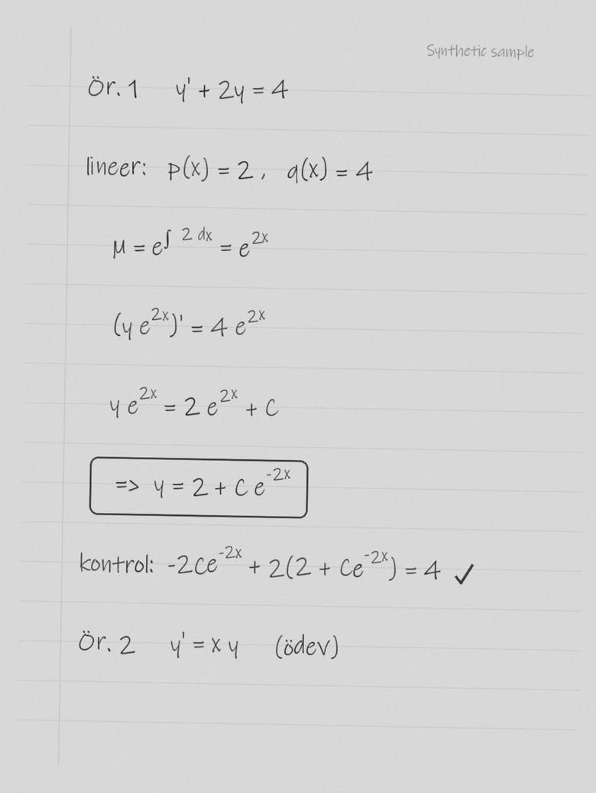
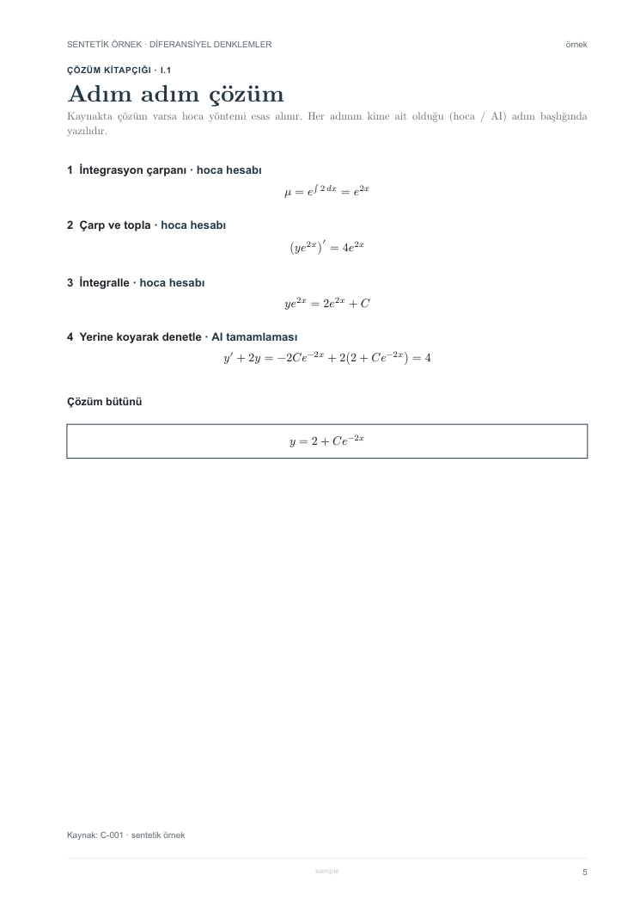
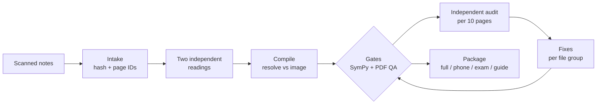

# lecture-notes-pipeline

**An AI-assisted production pipeline that turns handwritten lecture notes into traceable, verified
digital textbooks.**

> Türkçe özet: [README.tr.md](README.tr.md)

This is an independent, volunteer student project from the Mathematical Engineering department at
Yıldız Technical University. It is not an official or lecturer-endorsed publication.
This repository contains the **system** (architecture, rules, agent briefs, Typst template and
verification scripts). It does **not** contain any lecture notes, scans, produced books or exam
questions. All examples are synthetic.

| Input (synthetic scan) | Output (generated page) |
|:---:|:---:|
|  |  |
| *Synthetic sample, written for this repository and rendered to look like a scan ([generator](docs/img/make_synthetic_scan.py)). Not a real lecturer's note.* | *Synthetic sample: page 5 of [`example.pdf`](examples/numeric-branch/example.pdf), the step-by-step solution. Each step names its source: `hoca hesabı` (lecturer's calculation) or `AI tamamlaması` (AI completion).* |

---

## Problem

Lecture notes in many mathematics courses exist only as scanned handwriting. They are hard to read on
a phone, hard to search, and contain the occasional slip. Running them through an LLM produces a clean
text quickly, but in a form nobody can check: the model misreads symbols, quietly "fixes" the
lecturer's notation, and mixes its own explanations with the original. For a student preparing for
that lecturer's exam, an unverifiable clean copy is worse than the messy original.

## Approach

Treat LLM output as a draft that must pass gates, and keep every line traceable to a physical page.

- **No OCR as a source.** Each page is read from the image by two independent agents, and their
  differences are decided against the image.
- **Separate layers.** The lecturer's content and the AI's explanations, additions and solutions are
  kept in labelled layers. Lecturer errors are preserved with `[sic]` and corrected separately.
- **Visible uncertainty.** Unreadable spots become `[?]` or `Blocked`, never a guess.
- **Independent checks.** SymPy verifies stated results; independent auditors compare the book with
  the source page by page and can only write reports; fixers re-test each finding before applying it.
- **Human sign-off.** The pipeline never marks its own work as done; the user does after review.

## Pipeline



Full step-by-step description, roles and the verbal branch: [docs/architecture.md](docs/architecture.md).

## Layers and traceability

| Layer | Content |
|---|---|
| Lecturer note | What the lecturer wrote, as written, including errors marked `[sic]` |
| AI explanation | A re-telling: why the method works |
| AI addition | Something the lecturer did not write (domain check, missing step, verification) |
| AI solution | A solution to a question that has no solution in the source |

Every physical page has a permanent ID (`C-001`, ...), every question is registered against its page,
every page footer names its source, and an appendix reproduces the original page images. Solution steps
are labelled individually (`lecturer's calculation`, `AI reconstructed`, `AI solution`, ...), so a
reader can see who wrote each step. Labels are printed as text, so the layers survive grayscale
printing.

When the lecturer's solution is visible in the source, each example is a four-page cycle:
**lecturer note -> AI explanation -> try it yourself -> step-by-step solution**.

## Quality assurance

| Risk | Control |
|---|---|
| Misread symbols | Two independent readings; differences decided from the image |
| Silent "corrections" | OCR banned as a source; `[sic]` + separate AI correction; fidelity audit |
| Wrong AI solutions | SymPy gate on every result claim, with a self-test that must reject wrong claims |
| AI content passed off as the lecturer's | Layer labels; audit checklist item "Layers" |
| Skipped material | Question register; N/N page and question coverage |
| Wrong answer keys (question banks) | Blind solver (no key) + auditor + referee; only the referee may change an answer |
| Stems or options edited in passing | Fidelity gate: stems/options unchanged, answer changes only with referee authorisation and a visible AI note |
| Layout defects | PDF QA: overflow, near-empty pages, page mark on every page, broken links |

Details: [docs/quality-assurance.md](docs/quality-assurance.md). Reasoning behind the choices:
[docs/design-decisions.md](docs/design-decisions.md).

## Outputs

Each course package consists of:

- **Full edition**: the textbook, with clickable contents, a clickable question index and PDF bookmarks.
- **Phone edition**: the same book, built for reading on a phone.
- **Exam booklet**: past exams, typeset under the same layer and fidelity rules.
- **Reading guide**: a short guide to the labels and how to use the book.

## Status and reach

- **4 course packages ready**: Differential Equations, Statistics, Linear Programming Theory, Mechanics.
- **In progress**: Advanced Calculus.
- Shared with the department's class groups of 300–400 students.
- **Verbal branch**: blind-solver / auditor / referee answer verification for already-typeset question
  sets, shown here on a synthetic example only.

## Repository layout

| Path | Content |
|---|---|
| [`docs/`](docs/) | Architecture, quality assurance, design decisions |
| [`prompts/`](prompts/) | Generic agent briefs: reader, auditor, blind solver, referee |
| [`templates/textbook.typ`](templates/textbook.typ) | Typst template for the numeric branch |
| [`scripts/`](scripts/) | Intake, SymPy gate, PDF QA, answer comparison, fidelity gate |
| [`examples/numeric-branch/`](examples/numeric-branch/) | Synthetic ODE example: Typst source, compiled PDF, SymPy plug-in |
| [`examples/verbal-branch/`](examples/verbal-branch/) | Synthetic question set showing the comparison and fidelity gates |

## Quick start

Requires Python 3.10+ and [Typst](https://typst.app) 0.14 or later (tested with 0.15.1).

```bash
python -m venv .venv
.venv/bin/pip install -r requirements.txt        # Windows: .venv\Scripts\pip

# Numeric branch: build the synthetic example and run the gates
typst compile examples/numeric-branch/main.typ examples/numeric-branch/example.pdf --root .
python -I scripts/verify_solutions.py --checks-dir examples/numeric-branch/checks
python -I scripts/verify_solutions.py --selftest
python -I scripts/pdf_qa.py examples/numeric-branch/example.pdf --mark sample

# Verbal branch: route disagreements to the referee, then check fidelity
python -I scripts/compare_answers.py examples/verbal-branch
python -I scripts/fidelity_check.py examples/verbal-branch
python -I scripts/fidelity_check.py examples/verbal-branch final_tampered.json   # expected to fail

# A new course: extract page images and build the inventory
python -I scripts/extract_source.py <scan.pdf> <project_dir>
```

## Limitations and ethics

- **Copyright and consent.** Lecture notes belong to their lecturers. Produced books are shared only
  inside the class; they are not published here, and this project does not claim lecturer approval.
- **Not a replacement for the original.** When in doubt, the original page wins; that is why every
  book reproduces the original page images.
- **Residual errors.** The gates reduce errors; they do not eliminate them. SymPy proves that a
  stated result satisfies its equation, not that the transcription is faithful; that part rests on two
  readings and a human-readable audit. Remaining open spots are listed rather than hidden.
- **Agent cost.** Independence means more agent runs per page. This is a deliberate trade of speed
  for verifiability.
- **Language.** The produced books are in Turkish, so template component names and labels are Turkish.
  An English glossary is in [docs/architecture.md](docs/architecture.md#template-components-turkish-names).

## Tech stack

- **Typst**: typesetting, navigation (bookmarks, clickable contents and index), build variants
- **Python**: SymPy (solution verification), PyMuPDF (page extraction, PDF QA)
- **Claude via Claude Code**: multi-agent workflow (readers, compilers, auditors, fixers; blind solver,
  auditor, referee), orchestrated by a main session that owns shared files
- **Google Drive**: distribution of the finished packages

## License

Code (`scripts/`, `templates/`, `examples/`) is released under the [MIT License](LICENSE).
Documentation and agent briefs (`docs/`, `prompts/`, README files) may be reused under the same terms.
No lecture content is included or licensed.
