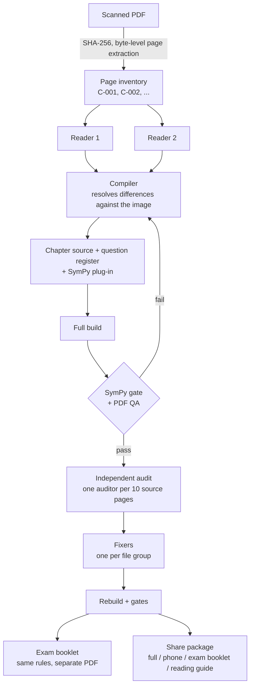
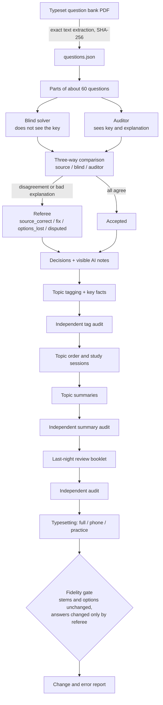

# Architecture

The pipeline has two branches that share one design language and one rule: **the source is never
silently changed, and everything the AI adds is labelled as AI.**

- **Numeric branch.** Handwritten or scanned mathematics lecture notes become a textbook, a phone
  edition, an exam booklet and a reading guide.
- **Verbal branch.** An already-typeset question bank (for example a medical exam collection) becomes
  a verified, topic-ordered study book.

## Roles

One main session orchestrates, and sub-agents do narrow, file-owned jobs. Independence between
agents is the main quality mechanism, so agents that check each other never see each other's output
until a later step compares them.

| Role | Writes | Must not touch |
|---|---|---|
| Main session | shared files: template, `main.typ`, page inventory, rules, hand-over log | — |
| Reader (x2 per page group) | its own reading file | the other reader's file |
| Compiler (x1 per group) | the group's chapter, question register, SymPy plug-in, comparison report | shared files |
| Auditor (x1 per 10 source pages) | its audit report only | every source file |
| Fixer (x1 per file group) | only the files assigned to it, plus a report | shared files; it writes requests to the main session instead |
| Blind solver / auditor / referee (verbal) | their own result JSON | the answer key (blind solver), other agents' results |

Two fixers never edit the same file. Requests that touch shared files go into a "for the main session"
section of the agent's report, and the main session applies them and rebuilds.

## Numeric branch

| # | Step | Output | Gate |
|---|---|---|---|
| 1 | Source intake. PDF not modified; SHA-256; pages extracted byte-for-byte | `source_pages/`, `inventory/pages.csv` | N/N pages, hashes recorded |
| 2 | Two independent readings per group of roughly 10 pages; no OCR | two reading files | Both cover every page |
| 3 | Comparison and compilation; differences decided from the image | chapter `.md` + `.typ`, question register, `checks_<group>.py` | Compiles |
| 4 | Merge and full build | book PDF | SymPy gate passes; PDF QA: overflow 0, near-empty 0 |
| 5 | Independent audit, fixed 10-page slices | `audit_<slice>.md` with old -> new fixes | Every finding has evidence |
| 6 | Fixes, grouped by file | edited files + fixer reports | Rebuild and gates pass again |
| 7 | Exam booklet from past exams, same layer rules | separate PDF | Same gates |
| 8 | Share package: page mark, clickable contents and index, bookmarks, reading guide | full, phone, exam booklet, guide | Mark count = page count; links resolve |
| 9 | Record: hand-over log (date, task, status, evidence) | `DEVIR.md`-style log | — |

### Traceability model

- `C-###` is the **physical PDF page** and never changes. Typesetting order may change; IDs do not.
- Every question has a unique ID (chapter in Roman numerals, then position: `III.2`) and is linked to
  its source page in the question register.
- Every chapter opening states which source pages it covers, and every page footer names its source.
- An appendix reproduces all original page images in physical order, so a reader can always compare
  the book with the original.

### Layers

Each sentence belongs to exactly one layer, and the layer name is always printed as text (colour is
never the only carrier, so the book survives grayscale printing).

| Layer | Meaning |
|---|---|
| Lecturer note | What the lecturer wrote, as written |
| AI explanation | A re-telling of the lecturer's note: why the method works |
| AI addition | Content that is not in the lecturer's note (domain checks, a missing step, a verification hint) |
| AI solution | A solution to a question that has no solution in the source |

Step labels on solution pages: `lecturer's calculation`, `lecturer's result`, `AI reconstructed`,
`AI solution`, `AI completion`, and `source calculation` / `source result` for material from another
source.

### Four-page cycle

Used only when the lecturer's own solution is visible in the source:

1. **Lecturer note**: the transcription, with margin notes.
2. **AI explanation**: why it works, plus a clearly separated AI addition if needed.
3. **Try it yourself**: the problem and an empty working area. The solution is not visible.
4. **Step-by-step solution**: maths first, little prose, every step labelled with who it comes from,
   and a final verification by substitution.

Questions that appear without a solution get pages 3 and 4 only, with every step labelled `AI solution`.

### Template components (Turkish names)

The books are in Turkish, so the Typst components in [`templates/textbook.typ`](../templates/textbook.typ)
have Turkish names:

| Component | Purpose |
|---|---|
| `ders` | Document setup: page geometry, fonts, header, footer with optional page mark |
| `bolum-baslangic` | Chapter opening with learning goals and source-page note |
| `tanim`, `teorem`, `not-kutu` | Definition, theorem, remark |
| `hoca-notu`, `ai-aciklama`, `kendin-coz`, `adim-cozum` | The four-page cycle |
| `kendini-denetle`, `ozet-kutu` | Self-check questions (AI), chapter summary |
| `yer-imi`, `soru-imi`, `ic-satir`, `soru-git` | Bookmarks, link targets, clickable contents and question index |

## Verbal branch

The source is already typeset, so text is extracted exactly and there is no reading step. The work
moves to **verification** and **re-organisation for learning**.

Invariants:

1. Stems and options are identical to the source. The only allowed visual fixes are broken symbols and
   options that were merged onto one line.
2. An answer changes only on a referee decision, and the change carries a visible AI note.
3. Every intervention and every added fact is labelled AI. Unlabelled text is source text.
4. Every AI-generated text (key facts, summaries, last-night booklet) is checked by a second,
   independent agent.

## Typesetting and outputs

- Typst, A4, black and white, serif body, generous display fractions on solution pages.
- Outputs per course: **full edition**, **phone edition** (lighter images for reading on a phone),
  **exam booklet**, and a short **reading guide**.
- Navigation: clickable table of contents, clickable question index, PDF bookmarks.
- A faint mark on every page is counted in QA: mark count = page count proves that every page came
  from the same build.
